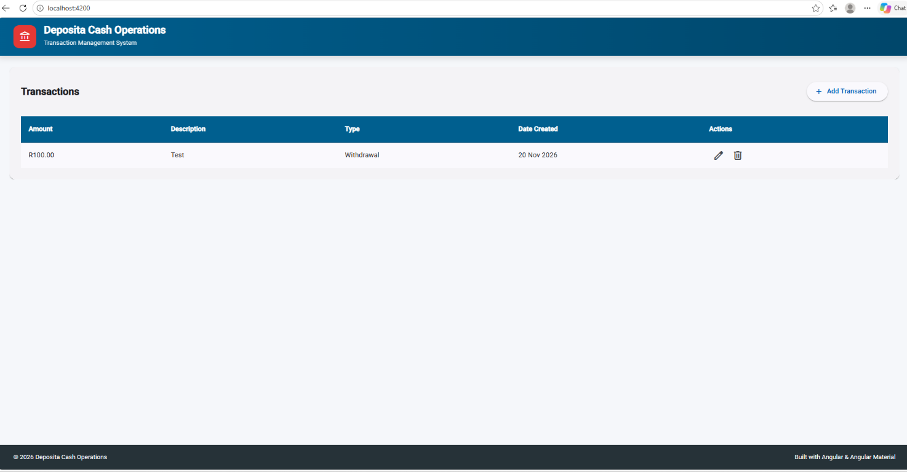
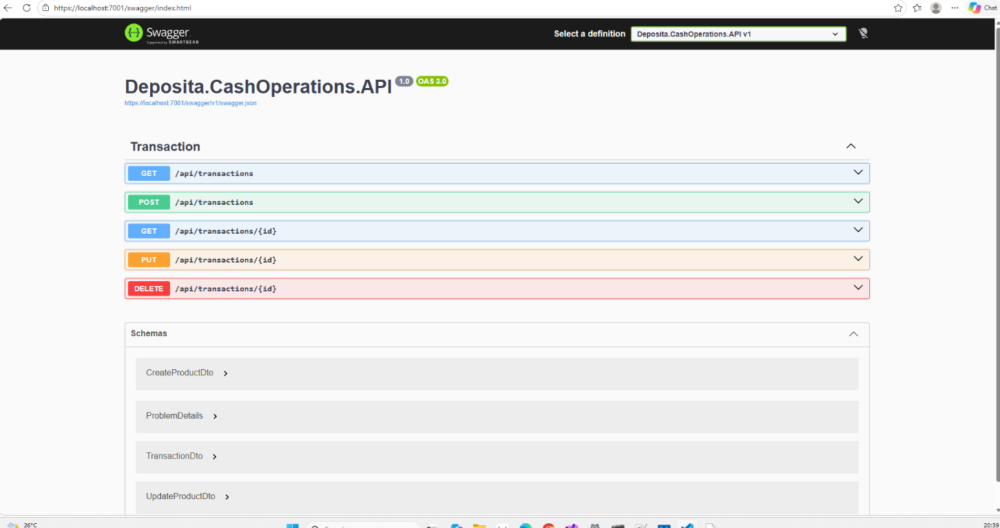

# Deposita Cash Operations

Deposita Cash Operations contains an ASP.NET Core API and an Angular web UI for managing cash transactions.

## Technology versions

Versions below are taken from the project files and lockfile. Installed SDK/runtime versions are those checked on the development machine when this guide was written; they are not pinned by the repository.

| Component | Version |
| --- | --- |
| .NET target framework | .NET 10 (`net10.0`) |
| .NET SDK checked | `10.0.403` |
| Node.js checked | `v26.13.0` |
| npm checked / declared | `11.20.0` |
| Angular CLI / framework (lockfile) | `22.3.0` |
| Angular Material / CDK (lockfile) | `22.3.0` |
| TypeScript (lockfile) | `6.0.3` |
| RxJS (lockfile) | `7.8.2` |
| Vitest / jsdom (lockfile) | `5.1.1` / `30.1.3` |
| Prettier (lockfile) | `3.10.1` |
| Entity Framework Core / SQL Server provider | `10.0.15` |
| AutoMapper | `16.3.0` |
| Swashbuckle (Swagger) | `11.0.1` |
| .NET test SDK / xUnit / runner | `17.14.1` / `2.9.3` / `3.1.4` |
| Coverlet collector | `6.0.4` |

The UI's `package.json` declares compatible version ranges; `package-lock.json` records the versions installed by `npm ci`. The Angular packages are locked to `22.3.0`.

Check your local tools before starting:

```powershell
dotnet --version
node --version
npm --version
```

Install the .NET 10 SDK and a Node.js release supported by the Angular CLI lockfile if these commands are missing or show incompatible versions.

## Prerequisites

1. Install the .NET 10 SDK, Node.js, and npm.
2. Provide access to a SQL Server instance.
3. Download `BankingDB.sql` in this repository, open it in SQL Server Management Studio, connect to the SQL Server instance you will use, and execute it. The script creates the `BankingDB` database and `dbo.Transactions` table. It contains explicit database-file paths; change the `FILENAME` paths if they do not exist on your SQL Server host. If the script is not in your checkout, create the database and table yourself. The API does not currently include EF Core migrations or create the database/schema automatically.
4. Replace the developer-specific `ConnectionStrings:DefaultConnection` value in `Deposita.CashOperations.API\Deposita.CashOperations.API\appsettings.Development.json` with a connection string for your own SQL Server instance and the `BankingDB` database created above. The checked-in value is for the original developer's machine and will not work on other machines as-is. Do not commit personal credentials or production connection strings.
5. Trust the ASP.NET Core development HTTPS certificate if it is not already trusted:

   ```powershell
   dotnet dev-certs https --trust
   ```

## Run the API

1. Open a PowerShell terminal at the repository root.
2. Restore and run the API:

   ```powershell
   cd .\Deposita.CashOperations.API
   dotnet restore .\Deposita.CashOperations.API.slnx
   dotnet run --project .\Deposita.CashOperations.API\Deposita.CashOperations.API.csproj
   ```

   The default launch profile uses the Development environment and listens on `https://localhost:7001` and `http://localhost:5001`.
3. Open Swagger at [https://localhost:7001/swagger](https://localhost:7001/swagger). If the browser reports a certificate warning, confirm the development certificate is trusted.

The transaction API is rooted at `https://localhost:7001/api/transactions`. It supports `GET /`, `GET /{id}`, `POST /`, `PUT /{id}`, and `DELETE /{id}`.

## Run the UI

Before starting the UI, make sure the API is still running and can connect to the configured database. Verify this by opening Swagger and successfully calling `GET /api/transactions`. Keep the API running, then open a second PowerShell terminal at the repository root.

1. Install the exact dependencies from the lockfile:

   ```powershell
   cd .\Deposita.CashOperations.UI
   npm ci/install
   ```

2. Start the Angular development server with either command:

   ```powershell
   npm start
   ```

   Or use the local Angular CLI to start the server and open the browser automatically:

   ```powershell
   npx ng serve -o
   ```

3. If the browser did not open automatically, navigate to [http://localhost:4200](http://localhost:4200). The UI's development environment is configured to call `https://localhost:7001/api`; keep the API running and connected to the database on that HTTPS port while using the UI.

The Angular development server reloads when application files change. Stop either server with `Ctrl+C` in its terminal.

## Screenshots

The running applications should look like the following:

### Transactions UI



### API (Swagger)



## Build and test

Run these commands from the corresponding project directories:

```powershell
# API solution: run tests
cd .\Deposita.CashOperations.API
dotnet test .\Deposita.CashOperations.API.slnx

# UI: production build and unit tests
cd ..\Deposita.CashOperations.UI
npm run build
npm test
```

## Troubleshooting

- **API fails to connect to SQL Server:** Check the `DefaultConnection` setting, SQL Server availability, database/table creation, and the account permissions.
- **UI shows request or network errors:** Confirm the API is running on HTTPS port `7001` and that the browser trusts the development certificate.
- **Port is already in use:** Stop the other process using the port or change the launch URL in the API's `Properties\launchSettings.json`; if the API HTTPS port changes, update `src\app\environments\environment.ts` in the UI to match.
